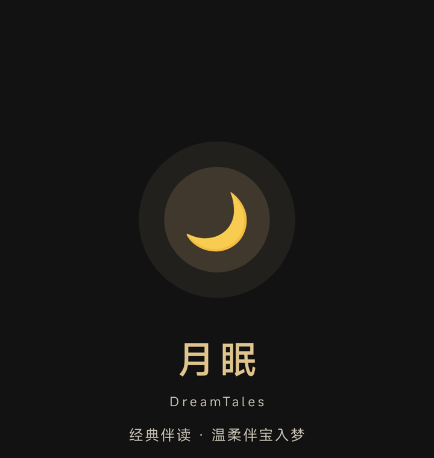
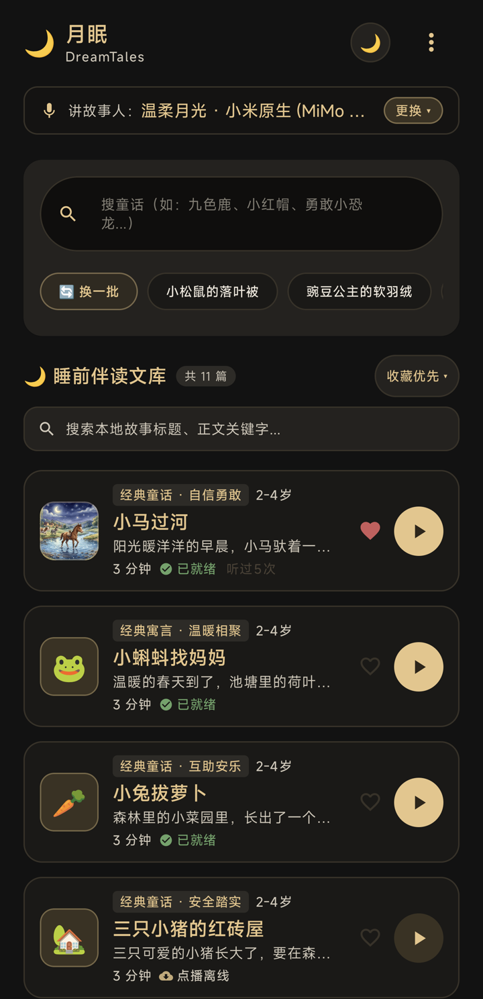
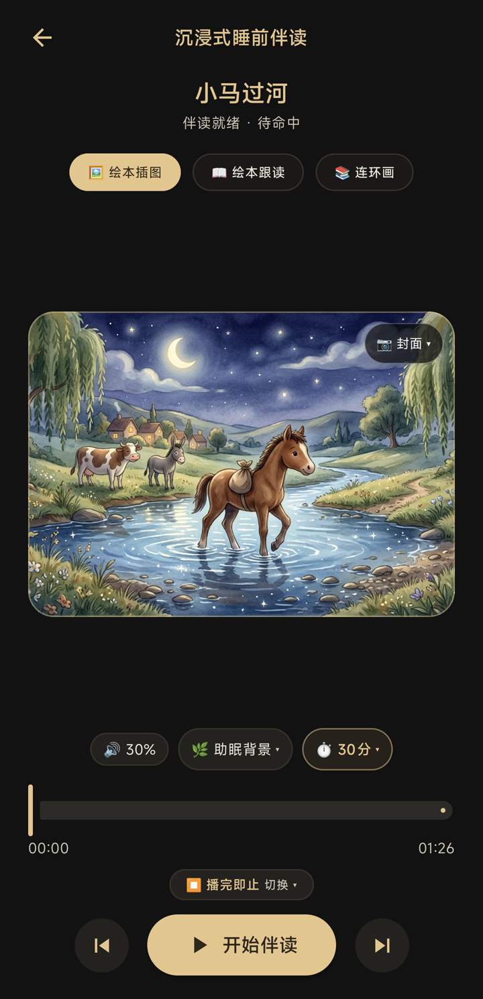
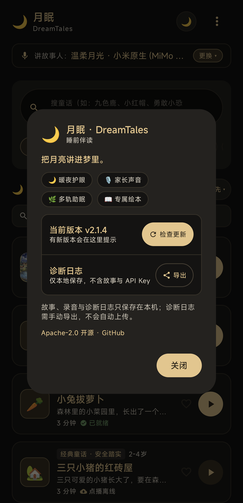

<div align="center">



# 🌙 月眠 DreamTales

**把月亮讲进梦里。**

为 2–6 岁孩子打造的温柔睡前故事与 AI 绘本伴读应用。

[](https://github.com/startips/DreamTales/releases/latest)
[-brightgreen?style=flat-square)](https://android.com)
[](https://kotlinlang.org)
[](https://developer.android.com/jetpack/compose)
[](LICENSE)

[📥 下载最新版](https://github.com/startips/DreamTales/releases/latest) · [📸 界面](#-界面) · [🔒 隐私](#-隐私) · [🛠 开发](#-开发)

</div>

---

## 📖 关于

月眠是一款 **Local-First** 的睡前伴读应用。经典童话、AI 故事、家长声音、专属绘本、多轨白噪音与睡眠定时，都收在一个安静的夜晚界面里。

支持 **Android 14+**，适配范围覆盖 Pixel、三星、小米、OPPO、vivo、荣耀近两年机型；华为 HarmonyOS 不在本轮支持范围。

## 📸 界面

| 首页 · 暖夜 | 首页 · 绘本米黄 | 沉浸式播放 | 关于 |
| :---: | :---: | :---: | :---: |
|  |  |  |  |

## ✨ 核心功能

- **家长声音**：20 秒录音克隆专属音色，离线缓存后随时开播。
- **故事与绘本**：经典童话 + AI 故事，自动分段并生成专属插画。
- **睡前声学**：最后 5 分钟语速与音量渐弱，睡眠定时到点温柔停止。
- **多轨白噪音**：雨、海浪、壁炉、虫鸣、摇篮曲自由混音。
- **宝宝主角**：把昵称、年龄、兴趣写进新故事，附陪伴周报。
- **家庭陪伴**：桌面小组件、局域网互传故事与音色。

## 📲 下载

- **最新正式版**：[GitHub Releases](https://github.com/startips/DreamTales/releases/latest)
- **系统要求**：Android 14+（API 34）
- **更新方式**：发现新版本时，右上角菜单显示小圆点；进入「关于」后点击「更新」即可。

## 🔒 隐私

故事、音频、封面、宝宝档案与诊断日志都保存在应用私有目录；录音样本仅通过 HTTPS 传给语音模型做即时克隆，不做非授权留存。没有广告或第三方统计 SDK。

## 🛠 开发

```bash
git clone https://github.com/startips/DreamTales.git
cd DreamTales
./gradlew assembleDebug
```

**技术栈**：Kotlin + Jetpack Compose + Media3 + Room，Local-First 架构。

验收清单见 [TESTING.md](TESTING.md)，发版由 GitHub Actions 完成。

## 📄 许可证

[Apache License 2.0](LICENSE)
